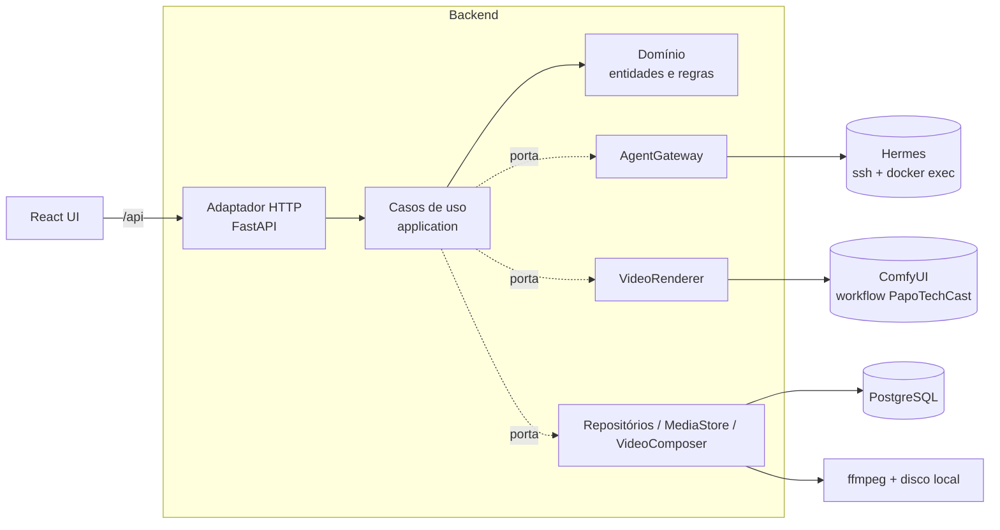
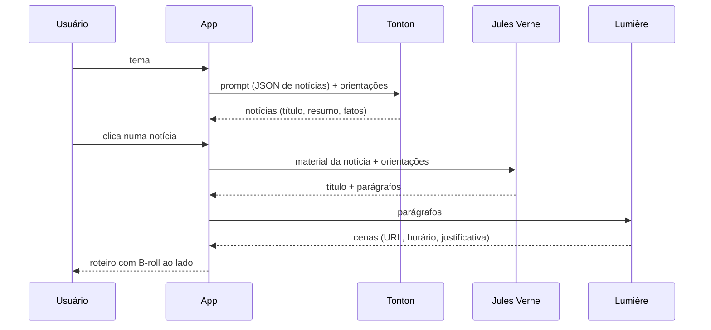
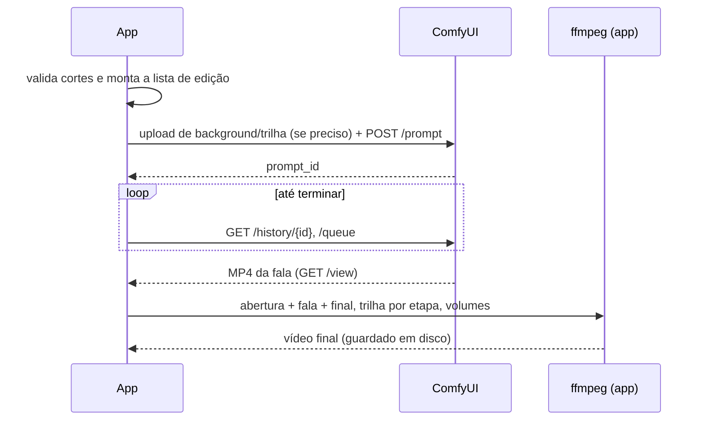

# Arquitetura

Backend em **Python 3.12+ / FastAPI / asyncpg** seguindo **arquitetura hexagonal (portas e adaptadores) com DDD**; frontend em **React + TypeScript + Vite**. Persistência no PostgreSQL `kontrul-postgres-1` (schema `content_studio`).



## Regra de dependência
`interfaces` e `infrastructure` dependem de `application` e `domain`; **nunca o contrário**. Domínio e aplicação só conhecem **portas** (`typing.Protocol`). Por isso os testes usam fakes em memória, sem banco, Hermes ou ComfyUI.

## Contextos delimitados (`backend/src/studio/`)

| Contexto | Responsabilidade | Agregados / conceitos |
|---|---|---|
| `shared` | Kernel: `Bot`, `JobStatus`, erros, portas `AgentGateway`, `BackgroundRunner`, `GuidelineSource` | — |
| `discovery` | Busca de notícias e Radar | `NewsSearch`, `NewsItem` |
| `scripting` | Roteiro, B-roll e cortes | `Script`, `Paragraph`, `BrollSuggestion`, `Cut`, `Excerpt` |
| `conversation` | Chat com bots e ações na tela | `Conversation`, `Message`, `ActionOutcome` |
| `guidance` | Orientações persistentes | `Guideline` |
| `rendering` | Envio ao ComfyUI, vinhetas, remix | `RenderJob`, `RenderAsset`, `EditPlan` |

Contextos não importam o domínio uns dos outros. Quando precisam de dados alheios, usam uma porta própria com um adaptador (anti-corruption layer): `NewsSourceReader` (scripting lê notícias), `ScriptSourceReader` (rendering lê roteiro e cortes), `StudioGateway` (chat executa ações nos outros contextos).

## Camadas

```
studio/
  <contexto>/domain/        entidades, regras, portas de repositório
  <contexto>/application/   casos de uso, prompts, parsing, portas de saída
  infrastructure/
    persistence/            repositórios asyncpg, migrador
    agents/                 HermesCliGateway (ssh + docker exec hermes -p <bot> -z)
    comfyui/                ComfyUiRenderer, preenchimento do workflow, workflow API (json)
    media/                  ffmpeg (probe, composição), armazenamento local
    runtime/                AsyncioBackgroundRunner
    config.py               variáveis de ambiente
  interfaces/http/          FastAPI: rotas, schemas, container de casos de uso
  bootstrap.py              composition root (liga portas aos adaptadores)
  migrate.py                aplica as migrações SQL
```

## Processamento assíncrono
Trabalhos demorados (bots, ComfyUI, ffmpeg) não rodam dentro da requisição:
1. O `POST` cria o registro em `running` e responde `202`.
2. Uma tarefa em segundo plano (porta `BackgroundRunner`) executa e grava o resultado.
3. O frontend consulta (polling) até o estado final.

Ao reiniciar, buscas/roteiros/mensagens que estavam rodando são marcados como falha ("Interrompido por reinício"); renderizações já aceitas pelo ComfyUI **retomam** o acompanhamento.

## Fluxos principais

### Notícia → roteiro → B-roll


### Envio ao ComfyUI e montagem final


## Decisões de projeto
- **Backend próprio**, em vez do backend genérico de páginas, porque é preciso orquestrar bots, ComfyUI e ffmpeg; usa o mesmo PostgreSQL, em schema dedicado.
- **Bots sem estado**: cada chamada ao Hermes é independente; o histórico do chat vem do banco e vai no prompt.
- **Saída estruturada dos bots**: os prompts pedem JSON; o parser tolera texto em volta e blocos ```json; URLs do YouTube são validadas.
- **Ações do chat** em blocos `<acao>{json}</acao>`, validados e limitados a 3 por resposta.
- **Montagem das vinhetas no app** (ffmpeg), sem alterar o nó do ComfyUI; só o volume do áudio do background vive no workflow (`volume_fundo`).
- **Workflow no formato API gerado** a partir do workflow visual (`backend/scripts/convert_workflow.py`), preenchido por **classe e ligação dos nós**, não por id/título.
- **Testes**: unitários com fakes por porta, adaptadores contra transportes simulados e mídia **real com ffmpeg**.
